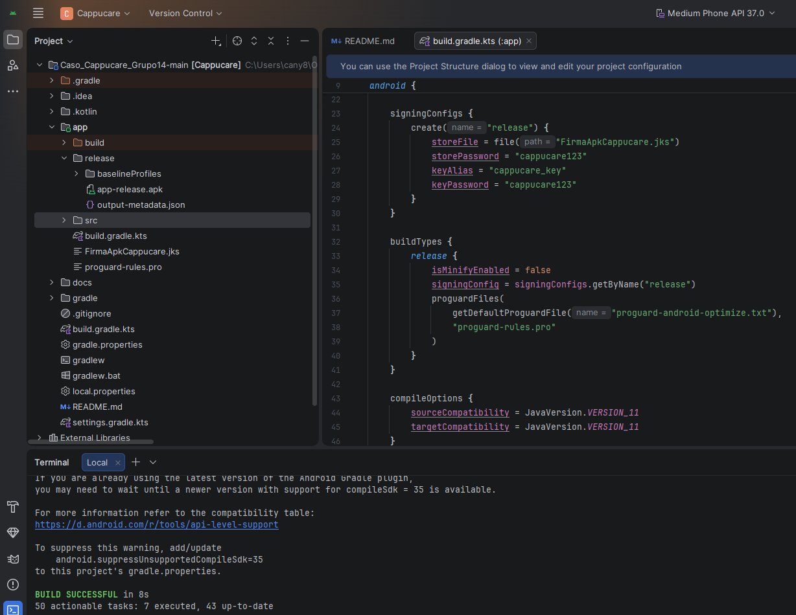

# 📦 Cappucare Stock — Control Inteligente de Existencias (DSY1105)

Aplicación móvil Android desarrollada con **Kotlin**, **Jetpack Compose**, **Material Design 3** y arquitectura **MVVM** para el caso de Vinculación con el Medio (VcM) **Cappucare** — Sede San Bernardo (Sección 001).

## 👥 Integrantes del Equipo (Grupo 14)
- **Jorge Aguilera**
- **Camila Henríquez**
- **Gustavo Soto**
- **Priscila Calderón**

## 🔗 Enlace al Repositorio GitHub
- **Repositorio oficial:** `https://github.com/Jvrge999/Caso_Cappucare_Grupo14.git`

---

## 🚀 Cómo ejecutar la aplicación y las pruebas

### Ejecutar la app en emulador o dispositivo físico
1. Clonar el repositorio:
   ```bash
   git clone [https://github.com/Jvrge999/Caso_Cappucare_Grupo14.git](https://github.com/Jvrge999/Caso_Cappucare_Grupo14.git)
   ```
2. En **Android Studio**, ir a `File > Open...` y seleccionar la carpeta raíz del proyecto (la que contiene `settings.gradle.kts`).
3. Verificar que el **Gradle JDK** esté configurado en **JDK 17 o JDK 21** (`Settings > Build, Execution, Deployment > Build Tools > Gradle`).
4. Esperar a que finalice el **Gradle Sync** y presionar **Run ('app')** sobre un emulador o dispositivo físico con **Android 7.0 (API 24)** o superior (`compileSdk = 35`, `targetSdk = 35`).

### Ejecutar las pruebas unitarias (JUnit 5 + Kotest)
1. Abrir `app/src/test/java/com/cappucare/app/viewmodel/CappucareViewModelTest.kt` y presionar el botón verde **Run (`▶`)** junto a `class CappucareViewModelTest`.
2. También se pueden ejecutar por consola desde la raíz del proyecto:
   ```bash
   ./gradlew testDebugUnitTest
   ```

---

## 🔐 Usuarios de Prueba y Permisos por Perfil (RF-00 / RNF-04)

Se **eliminó el acceso rápido de «Modo desarrollo»**, se incorporó **validación visual con íconos** en el inicio de sesión y se implementó control de permisos diferenciado por perfil dentro de `CappucareViewModel`:

| Perfil | Usuario (Correo) | Contraseña | Permisos y restricciones aplicadas |
| :--- | :--- | :--- | :--- |
| **Personal encargado** | `encargado@cappucare.cl` | `encargado123` | Acceso total: crear y editar productos, cambiar estados, registrar **ingresos** y **salidas**, consultar alertas e historial completo. |
| **Usuario autorizado** | `ventas@cappucare.cl` | `ventas123` | Consulta de catálogo, historial y registro de **salidas**. Si intenta registrar un **ingreso** o modificar el catálogo, el `ViewModel` rechaza la operación y muestra un mensaje claro en pantalla. |

---

## ✅ Requerimientos y Reglas de Negocio Implementadas

El proyecto cumple íntegramente la regla de negocio central **RN-03 ("El stock nunca queda negativo")** junto al flujo completo de inventario, seguridad, persistencia local y recursos nativos:

- **RN-03 (El stock nunca queda negativo):** Validación de doble barrera en `CappucareViewModel` (`validarMovimiento()` y `registrarMovimiento()`). Impide registrar salidas por una cantidad superior al stock disponible, informando `"Solo hay N disponibles"`.
- **RN-01 y RF-07 (Stock derivado de movimientos):** Cuadratura de datos iniciales en `MockData.kt` (`M1` a `M11`), precarga inicial en SQLite y actualización automática del stock disponible y del estado (`DISPONIBLE` ↔ `AGOTADO`) tras cada ingreso o salida.
- **RN-02 y RF-05 (Registro de salidas y ventas):** Exigencia de motivo obligatorio en cada salida (`VENTA`, `MERMA`, `VENCIMIENTO`, `AJUSTE`, `OTRO`).
- **RN-05, RF-04 y RF-06 (Trazabilidad de ingresos y salidas):** Asignación automática de fecha/hora (`yyyy-MM-dd HH:mm`) y del nombre del usuario con sesión activa como responsable del movimiento.
- **RF-00, RF-01, RF-02, RF-03, RF-08, RF-09 y RF-10:** Autenticación con validación visual e íconos, control de permisos por perfil con retroalimentación de rechazo, gestión de productos con código único (`RN-04`), búsqueda y filtros por categoría, historial ordenado por fecha descendente y detección de productos bajo nivel mínimo (`RN-07`).

---

## 🏛️ 1. Contexto del Caso, Modelo de Datos y Persistencia Local (Criterio D3)

### Problemática abordada y Regla de Negocio Principal (RN-03)
El sistema resuelve el descontrol de inventario de insumos médicos mediante la implementación estricta de la **Regla de Negocio RN-03 ("El stock nunca queda negativo")**, conectada directamente con:
- **RF-05 (Registrar salida de existencias):** Toda salida exige cantidad válida (`> 0`) y motivo obligatorio.
- **RF-07 (Actualización automática de stock):** El stock disponible nunca se edita manualmente; se calcula siempre a partir de `Ingresos - Salidas`.

### Modelo de Datos y Persistencia Local Implementada con Room (SQLite)
La aplicación persiste productos y movimientos de forma local en SQLite mediante **Room + KSP** (`cappucare_stock.db`), manteniendo los cambios tras cerrar y reabrir la app (`RNF-01` offline-first):
- **`data/local/ProductoEntity.kt` y `data/local/MovimientoEntity.kt`:** Entidades `@Entity` para las tablas `"productos"` y `"movimientos"`, relacionadas mediante `@ForeignKey` sobre `productoId` (con índice y borrado en cascada) y funciones de mapeo (`toDomain()` / `toEntity()`) hacia `model/Producto.kt` y `model/Movimiento.kt`.
- **`data/local/ProductoDao.kt` y `data/local/MovimientoDao.kt`:** Interfaces `@Dao` con consultas reactivas que retornan `Flow<List<...>>` (catálogo ordenado por nombre, productos bajo mínimo e historial descendente) y operaciones de escritura `suspend` (`insertar`, `insertarTodos`, `actualizar`).
- **`data/local/AppDatabase.kt`:** Base de datos `@Database(version = 1)` con patrón singleton (`getInstance(context)`) y método `precargarSiEstaVacia()`, que pobla SQLite una sola vez con los 8 insumos (`P1` a `P8`) y 11 movimientos cuadrados (`M1` a `M11`) definidos en `data/MockData.kt`.

---

## 📱 2. Interfaz de Usuario, Animaciones y Recursos Nativos (Criterios D4 y D5)

### Diseño con Jetpack Compose y Material 3
- **`navigation/AppNavigation.kt`:** Centraliza el `NavHost`, instancia un único `CappucareViewModel` compartido conectado a `AppDatabase` mediante `CappucareViewModel.factory(LocalContext.current)` y limpia la pila de navegación al cerrar sesión (`logout()`).
- **`ui/screen/LoginScreen.kt`:** Interfaz de acceso sin modo desarrollo, con íconos de estado/error, visibilidad de contraseña y retroalimentación inmediata por campo.
- **`ui/screen/movimientos/RegistrarMovimientoScreen.kt` y `ui/screen/productos/ProductosScreen.kt`:** Observan los cambios del `ViewModel` en tiempo real mediante `collectAsState()`.
- **Separación UI / Lógica:** Los `@Composable` solo dibujan el estado y muestran errores bajo cada campo (`isError`, `supportingText`); **ningún cálculo de stock ni validación de negocio se realiza dentro de la pantalla**.

### Animaciones Funcionales en Jetpack Compose
- **`ui/components/SelectorDesplegable.kt`:** Rotación fluida de la flecha desplegable (`animateFloatAsState`) y aparición/ocultamiento suave de errores (`AnimatedVisibility` con `fadeIn() + expandVertically()` y `fadeOut() + shrinkVertically()`).
- **`ui/screen/productos/ProductosScreen.kt`:** Transición animada de color de fondo y borde (`animateColorAsState`) e ícono de alerta en las tarjetas de insumos bajo su `nivelMinimo`, además de `animateContentSize()`.
- **`ui/screen/movimientos/RegistrarMovimientoScreen.kt`:** Animaciones con `AnimatedVisibility` para mostrar u ocultar el selector de motivo según el tipo de movimiento, desplegar el banner de error ante rechazos por perfil y actualizar suavemente la tarjeta de disponibilidad (`animateContentSize()`).

### Recursos Nativos y Gestión de Permisos (RNF-01, RNF-02)
Declarados en `app/src/main/AndroidManifest.xml` y solicitados en tiempo de ejecución con `rememberLauncherForActivityResult(ActivityResultContracts.RequestPermission())`:

1. **Notificación Local de Stock Mínimo (`POST_NOTIFICATIONS`):**
- Implementada en `app/src/main/java/com/cappucare/app/ui/components/NotificacionStockHelper.kt`.
- En Android 13+ (API 33+) solicita el permiso `android.permission.POST_NOTIFICATIONS` y crea el canal `cappucare_stock_minimo_channel`.
- Al registrar un movimiento que deja a un producto activo con `cantidadDisponible < nivelMinimo`, dispara una notificación local con el código, nombre, stock restante y mínimo configurado.
2. **Escáner de Códigos QR (`CAMERA`):**
- Declarado con `<uses-permission android:name="android.permission.CAMERA" />` y `<uses-feature android:name="android.hardware.camera" android:required="false" />`.
- Integrado en **`ProductosScreen.kt`** (botón QR en la barra de búsqueda para filtrar el insumo escaneado) y en **`RegistrarMovimientoScreen.kt`** (botón QR junto al selector para elegir automáticamente el producto por código o ID, ej. `PRO-002`).
- Maneja de forma explícita el rechazo del permiso mostrando un aviso en pantalla e incluye un diálogo de ingreso manual de respaldo para facilitar pruebas en emuladores sin cámara física.

---

## 🔄 3. Arquitectura MVVM y Cómo Viaja el Dato (Criterio D2)

El proyecto aplica el patrón **MVVM (Model - View - ViewModel)** garantizando un flujo unidireccional de datos:

1. **Evento en la Vista (`UI`):** En `RegistrarMovimientoScreen.kt`, el usuario selecciona un producto (manualmente o escaneando su QR), elige tipo de movimiento, ingresa la cantidad y presiona **"Registrar movimiento"**.
2. **Primera Barrera en ViewModel (`validarMovimiento`):** Antes de procesar, la UI invoca `viewModel.validarMovimiento(productoId, tipo, cantidad, motivo)` en `CappucareViewModel.kt`.
- Si `tipo == TipoMovimiento.SALIDA` y `cantNum > prod.cantidadDisponible`, se activa **RN-03** devolviendo `ErroresMovimiento(cantidad = "Solo hay ${prod.cantidadDisponible} disponibles")`.
- La interfaz recibe el error y bloquea el guardado mostrando el mensaje animado bajo el campo.
3. **Control de Perfil, Segunda Barrera y Persistencia (`registrarMovimiento`):** Si la validación del formulario pasa, la UI invoca `viewModel.registrarMovimiento(...)`:
- Verifica permisos del perfil activo (`puedeRegistrarTipoMovimiento(tipo)`). Si un `USUARIO_AUTORIZADO` intenta un `INGRESO`, rechaza la operación y publica el motivo en `_mensajeRetroalimentacion`.
- Aplica la segunda barrera de **RN-03** (`if (tipo == TipoMovimiento.SALIDA && cantidad > prod.cantidadDisponible) return false`).
- Obtiene fecha/hora actual (`SimpleDateFormat("yyyy-MM-dd HH:mm")`) y el nombre del usuario en sesión (`_usuarioActivo.value?.nombre`).
- Recalcula `nuevaCantidad`, actualiza automáticamente el estado (`AGOTADO` si llega a `0`, o `DISPONIBLE` si se reabastece desde `AGOTADO`) y guarda tanto el movimiento como el producto actualizado en **Room** (`movimientoDao().insertar(...)` y `productoDao().actualizar(...)`) dentro de `viewModelScope`.
4. **Reacción Automática (`Flow` → `StateFlow`) y Notificación Local:** Los cambios en SQLite y en `_productos` actualizan automáticamente todas las pantallas suscritas con `collectAsState()`, y `RegistrarMovimientoScreen` invoca `NotificacionStockHelper.notificarSiStockBajoMinimo(context, actualizado)` para alertar si el insumo quedó bajo su mínimo.

---

## 🧪 4. Pruebas Unitarias Automatizadas (JUnit 5 + Kotest)

Se configuró el entorno de testing en `gradle/libs.versions.toml` y `app/build.gradle.kts` habilitando `useJUnitPlatform()` con **JUnit 5 (`5.11.4`)** y **Kotest Assertions (`5.9.1`)**.

La suite **`app/src/test/java/com/cappucare/app/viewmodel/CappucareViewModelTest.kt`** verifica integralmente la lógica de negocio del `CappucareViewModel` (inyectando `db = null` para ejecución aislada en memoria):
- **Autenticación (`RF-00`):** Validación de campos vacíos, credenciales incorrectas, `limpiarErrorLogin()`, inicio de sesión exitoso y limpieza total en `logout()`.
- **Permisos por Perfil:** Bloqueo de `guardarProducto()` y `registrarMovimiento(INGRESO)` para `USUARIO_AUTORIZADO` con generación de mensaje de retroalimentación.
- **Regla RN-03 y Validaciones de Movimiento:** Rechazo cuando la salida excede el stock disponible (en `validarMovimiento` y en la segunda barrera de `registrarMovimiento`), obligatoriedad de motivo en salidas y rechazo de cantidades `<= 0`.
- **Ciclo de Vida de Stock e Historial:** Transición automática a `AGOTADO` al llegar a `0`, reactivación a `DISPONIBLE` tras un ingreso y consistencia de `historialDe(productoId)` y `historialDe(null)`.
- **Gestión de Catálogo y Alertas:** Validación de código duplicado (`RN-04`), creación con stock inicial `0`, edición conservando stock actual, búsqueda con filtro por categoría (`buscarProductos`) y exclusión de productos `DADO_DE_BAJA` en `productosBajoMinimo()`.

---

## 🛠️ 5. Guía Técnica de Extensibilidad y Modificaciones en Tiempo Real (Criterio D6)

Documentación de referencia rápida sobre los puntos de extensión en `CappucareViewModel.kt` y `Movimiento.kt` para ajustes de reglas de negocio en tiempo real:

### Modificación A: Personalizar el mensaje de error de RN-03 (incluir nombre y unidad de medida)
- **Archivo:** `app/src/main/java/com/cappucare/app/viewmodel/CappucareViewModel.kt`
- **Función:** `validarMovimiento(...)`
- **Implementación:** Reemplazar la condición de `RN-03` dentro de `val errorCant = when`:
  ```kotlin
  // Antes:
  tipo == TipoMovimiento.SALIDA && prod != null && cantNum > prod.cantidadDisponible ->
      "Solo hay ${prod.cantidadDisponible} disponibles"

  // Después (incluyendo nombre del producto y etiqueta de unidad):
  tipo == TipoMovimiento.SALIDA && prod != null && cantNum > prod.cantidadDisponible ->
      "Stock insuficiente de ${prod.nombre}: quedan ${prod.cantidadDisponible} (${prod.unidadMedida.etiqueta})"
  ```

### Modificación B: Agregar un tope máximo de unidades por cada salida (ej. máximo 20 unidades por operación)
- **Archivo:** `app/src/main/java/com/cappucare/app/viewmodel/CappucareViewModel.kt`
- **Función:** `validarMovimiento(...)`
- **Implementación:** Agregar una nueva rama de validación en el bloque `when`:
  ```kotlin
  val errorCant = when {
      cantNum == null || cantNum <= 0 -> "Ingresa una cantidad mayor que 0"
      tipo == TipoMovimiento.SALIDA && prod != null && cantNum > prod.cantidadDisponible ->
          "Solo hay ${prod.cantidadDisponible} disponibles"
      // Nueva regla: limitar cantidad máxima permitida en una sola salida
      tipo == TipoMovimiento.SALIDA && cantNum > 20 ->
          "No se permiten salidas mayores a 20 unidades por operación"
      else -> null
  }
  ```

### Modificación C: Extensión de motivos de salida y restricción por estado de producto

#### Caso C.1 — Agregar un nuevo motivo de salida al selector desplegable
- **Archivo:** `app/src/main/java/com/cappucare/app/model/Movimiento.kt`
- **Clase:** `enum class MotivoSalida`
- **Implementación:** Agregar el nuevo valor al enumerado (la interfaz lo carga automáticamente en el `DropdownMenu`):
  ```kotlin
  enum class MotivoSalida(val etiqueta: String) {
      VENTA("Venta"),
      MERMA("Merma / daño"),
      VENCIMIENTO("Vencimiento"),
      AJUSTE("Ajuste de inventario"),
      PRESTAMO("Préstamo interno"), // Nuevo motivo de salida
      OTRO("Otro")
  }
  ```

#### Caso C.2 — Bloquear movimientos sobre productos con estado `DADO_DE_BAJA`
- **Archivo:** `app/src/main/java/com/cappucare/app/viewmodel/CappucareViewModel.kt`
- **Función:** `validarMovimiento(...)` (variable `val errorProd`)
- **Implementación:** Reemplazar la validación simple de `errorProd` por un bloque `when`:
  ```kotlin
  val errorProd = when {
      prod == null -> "Elige un producto"
      prod.estado == EstadoProducto.DADO_DE_BAJA ->
          "Este producto está dado de baja y no admite movimientos"
      else -> null
  }
  ```

---

## 🌿 6. Flujo de Trabajo Colaborativo en Git (Ramas y Pull Requests)

Para garantizar trazabilidad individual y una integración ordenada sin commits directos a `main`, el equipo trabaja con **ramas por funcionalidad (`feature/...`)** creadas desde **Android Studio** y **Pull Requests (PR)** revisados en GitHub:

| Rama | Responsable | Alcance principal |
| :--- | :--- | :--- |
| `feature/login-roles-room` | Jorge Aguilera | Eliminación del modo desarrollo y validación visual en `LoginScreen.kt`, control de permisos por perfil en `CappucareViewModel.kt`, persistencia local con Room (`data/local/*` y `AppNavigation.kt`), llave `FirmaApkCappucare.jks` y `app-release.apk`. |
| `feature/animaciones-ui-components` | Camila Henríquez | Animaciones de transición de errores y rotación en `SelectorDesplegable.kt`, junto con alertas visuales y flujo de catálogo en `ProductosScreen.kt`. |
| `feature/recursos-nativos-qr-notificaciones` | Gustavo Soto | Permisos `CAMERA` y `POST_NOTIFICATIONS` en `AndroidManifest.xml`, `NotificacionStockHelper.kt` y escáner QR en `RegistrarMovimientoScreen.kt`. |
| `feature/tests-unitarios-readme` | Priscila Calderón | Configuración de JUnit 5 + Kotest y `signingConfigs` en Gradle (`libs.versions.toml` y `app/build.gradle.kts`), suite `CappucareViewModelTest.kt`, captura `docs/evidencia_apk_firmado.png` y actualización integral del `README.md`. |
---

## 🔐 7. Firma y Generación del APK de Producción (IE 3.3.1)

La aplicación cuenta con configuración de firma digital para publicación en `app/build.gradle.kts` mediante el bloque `signingConfigs` apuntando al almacén de claves **`app/FirmaApkCappucare.jks`** (alias `cappucare_key`, algoritmo `SHA256withRSA` de 2048 bits).

### Comandos utilizados para generar y verificar la firma
1. Verificación del certificado y alias:
   ```powershell
   keytool -list -v -keystore app/FirmaApkCappucare.jks
   ```
2. Generación del APK firmado (`release`):
   ```powershell
   ./gradlew assembleRelease
   ```

### Evidencia del APK firmado y llave `.jks`
- **APK firmado:** `app/release/app-release.apk`
- **Llave de firma:** `app/FirmaApkCappucare.jks`

